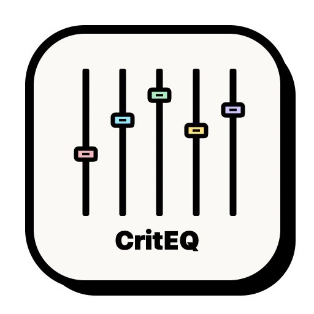
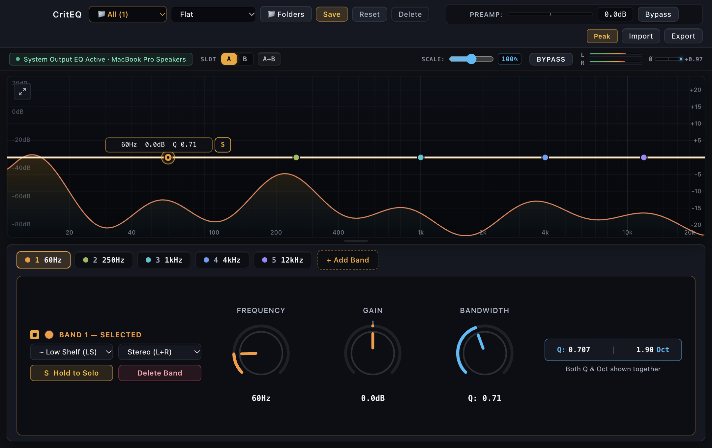

<div align="center">



# 🎚️ CritEQ

**Mastering-Grade System-Wide Parametric Equalizer for macOS**  
*Built for Audio Engineers, IEM Enthusiasts, and Critical Listeners.*

[](./LICENSE)
[](https://apple.com)
[](https://github.com/IniMaiss/CritEQ)
[](./Preset)
[](./LEGAL_AND_COMPLIANCE.md)

<br/>
<br/>



<br/>
<sub><em>Classic Light Paper Neobrutalism UI: Interactive Parametric EQ Canvas, Real-Time FFT Spectrum Analyzer, A/B Slot Auditioning, and Precision L/R Output Meters.</em></sub>

</div>

---

> [!IMPORTANT]
> ### 🔒 100% Privacy & Anti-Spying Guarantee
> **CritEQ is built strictly for audio quality and local mastering. It is NOT spyware and does NOT record or monitor your activity.**
> - **Zero Spying & Zero Wiretapping:** The macOS *CoreAudio Process Tap* is used **exclusively** to route audio through the parametric equalizer filters in volatile RAM in real time, then immediately outputs to your headphones or speakers.
> - **Zero Audio Recording:** Audio frames are processed purely in ephemeral RAM and **are never recorded, cached, or written to disk**.
> - **100% Offline with Zero Telemetry:** CritEQ contains zero network request code (`fetch`, `http`, sockets), zero analytics SDKs, and zero telemetry endpoints. **Absolutely no audio, user data, or telemetry is ever transmitted to the repository owner, maintainers, or any third party.**
> - **Verifiable Open-Source:** Every line of code is open source and auditable. You can inspect [`src/native/native-audio-engine.swift`](./src/native/native-audio-engine.swift) and the frontend codebase to verify that no network or recording backdoors exist.

---

> [!NOTE]
> ### 🛡️ Independent Clean-Room Implementation
> **CritEQ is an independent, 100% clean-room open-source project written from scratch.**
> - **Architecture & Code:** All Swift native audio tapping code and TypeScript/Electron frontend logic were authored entirely from first principles. No proprietary code, binaries, or assets from third parties are used.
> - **Mathematical Foundation:** Filter calculations are derived from **Robert Bristow-Johnson's *Audio EQ Cookbook* (1994)**—the industry-standard, public-domain bilinear transform formulations utilized universally across digital audio workstations (DAWs) and audio plugins worldwide.
> - **Open Audio Standards:** Preset interoperability adheres strictly to open, plain-text parametric EQ formats popularized by Equalizer APO and AutoEq.

---

## 🌟 Overview

**CritEQ** brings mastering-studio precision to desktop system-wide audio. Designed with a distinctive **Classic Light Paper Neobrutalism** aesthetic (inspired by [ekmas/neobrutalism-components](https://github.com/ekmas/neobrutalism-components)), CritEQ combines tactile retro-hardware physical controls, chunky high-contrast borders, and clean studio telemetry. It allows you to equalize any audio playing on your computer in real time with zero latency overhead and zero virtual driver clutter.

CritEQ comes bundled with an indexed database of **over 5,900+ headphone & IEM parametric EQ presets** sourced from the world's leading acoustic measurement databases (**AutoEq**, **Crinacle**, **Squiglink**, and **oratory1990**).

---

## 🛣️ Development Progress & Roadmap

CritEQ has been built iteratively with strict adherence to clean-room engineering, audio fidelity, and user experience:

- [x] **Phase 1 — Zero-Driver CoreAudio Engine (macOS)**
  - Implemented driverless system-wide audio capture via Apple Silicon process tap (`AudioHardwareCreateProcessTap` / `CATapDescription`).
  - Completely eliminates the need for third-party kernel extensions (`.kext`) or virtual audio driver daemons.
- [x] **Phase 2 — High-Precision Biquad DSP**
  - Engineered double-precision Direct Form II Transposed biquad filter topologies (`PK`, `LS`, `HS`, `LP`, `HP`, `BP`, `NO`, `AP`).
  - Added hardware-accelerated Apple Accelerate (`vDSP`) real-time FFT spectrum analyzer.
  - Implemented an internal soft-clipping `tanh` limiting stage for hearing conservation and signal protection.
- [x] **Phase 3 — 5,900+ Acoustic Preset Database**
  - Integrated and indexed over 5,900+ headphone and IEM measurement profiles.
  - Built instant client-side fuzzy search across manufacturers, models, and measurement reviewers.
  - Added full two-way Equalizer APO `.peq` and `.txt` import and export capabilities.
- [x] **Phase 4 — Classic Paper Neobrutalism Interface**
  - Tactile Neobrutalism design system with warm paper surfaces (`#FAF7F2`), chunky 2px solid black borders, and hard unblurred drop shadows.
  - Ultra-clean parametric equalizer canvas (*canvas polos*) with tactile node handles and interactive drag acoustics.
  - Integrated Master Output Bar with A/B slot preset auditioning, global EQ gain intensity scaling (0%–200%), and high-contrast dual L/R peak and RMS meters.
  - Selected-Band Inspector Dock with simultaneous `Q` and `Octaves` readouts, vector rotary dials, and quick band switching.
- [ ] **Phase 5 — Windows Porting (In Active Progress 🚧)**
  - Architecting the native Windows audio backend utilizing **Windows Audio Session API (WASAPI)** and **Audio Processing Objects (APO)**.
  - Ensuring seamless cross-platform parity so Windows users can access the same driverless system-wide DSP, 5,900+ IEM presets, and minimalist UI.

---

## ✨ Features

- **🚀 Driverless System-Wide EQ (CoreAudio Process Tap):**
  Uses modern macOS user-space audio tapping (`AudioHardwareCreateProcessTap`). No kernel extensions, no Audio Server Plugins, and no system reboot required.
- **🎛️ Mastering-Grade DSP:**
  - Double-precision Direct Form II Transposed biquad filter topologies.
  - Supports Peaking (`PK`), Low-Shelf (`LS`), High-Shelf (`HS`), Low-Pass (`LP`), High-Pass (`HP`), Band-Pass (`BP`), Notch (`NO`), and All-Pass (`AP`).
  - Native soft-clipping `tanh` limiting stage preventing harsh digital overs.
- **📊 60 FPS Interactive Spectrum Canvas:**
  - Smooth interactive filter curve plotting with multi-band draggable node handles.
  - Real-time FFT spectrum analyzer (RTA) driven by hardware-accelerated Apple `vDSP`.
  - Dual `Q Factor` and `Bandwidth (Octaves)` live readout.
- **📚 5,900+ Pre-Calibrated IEM Presets:**
  - One-click tuning for brands like Moondrop, Sennheiser, Sony, KZ, Truthear, 64 Audio, DUNU, and hundreds more.
  - Fully compatible with **Equalizer APO** / **AutoEQ** `.txt` and `.peq` configuration files.
- **🔒 100% Offline & Private:**
  - Zero telemetry, zero analytics, zero network requests. Your audio stays purely in memory and never touches disk or external servers.

---

## 🎧 Presets & Measurement Rigs Notice

All presets included in CritEQ are pre-computed using the **AutoEq** optimization engine targeting the standard **Harman In-Ear 2019** or IEF Neutral target curves. 

The underlying frequency response measurements originate from:
- **[Squiglink Reviewers](https://squig.link)**: Measured primarily on standard **IEC 60318-4 (IEC-711 compliant / clone)** acoustic couplers.
- **[Crinacle](https://crinacle.com)**: Measured on **IEC-711** couplers and his high-resolution **Brüel & Kjær (B&K) Type 4620** measurement system.
- **[AutoEq / oratory1990](https://github.com/jaakkopasanen/AutoEq)**: Measured in controlled laboratory conditions using **GRAS 43AG / 45CA** ear simulators.

---

## 🛠️ Installation & Quick Start

### Prerequisites
- macOS Sonoma 14.2 or later *(Windows support in active development)*
- [Node.js](https://nodejs.org) (v18 or later)
- Xcode Command Line Tools (`xcode-select --install`) with `swiftc`

### ⚡ One-Click Automated Install (Recommended)
Clone the repository and run the automated installer script—it compiles the native audio engine and installs **CritEQ.app** directly into your `/Applications` folder:

```bash
git clone https://github.com/IniMaiss/CritEQ.git
cd CritEQ
./install.sh
```

Once installed, you can launch **CritEQ** immediately from Launchpad, Spotlight (`Cmd + Space` → `CritEQ`), or via terminal:
```bash
open /Applications/CritEQ.app
```

---

### 🔐 macOS System Audio Permission Disclosure
When you first launch CritEQ, macOS will prompt you to grant **"System Audio Recording" / "Microphone"** access:
- **Why this prompt appears:** Apple requires explicit user consent for applications using the user-space `AudioHardwareCreateProcessTap` API to read and equalize system audio without installing virtual drivers or kernel extensions.
- **Privacy & Anti-Spying Guarantee:** CritEQ **does not record**, save, or transmit your audio or conversations. All audio frames are processed entirely in local RAM and discarded immediately upon playback. Zero data leaves your machine.

---

## 📖 File Format & Interoperability

CritEQ supports importing and exporting parametric EQ configurations compatible with **Equalizer APO**, **Peace EQ**, and **Wavelet**:

```text
Device: Moondrop Blessing 3 (Super Review)
Preamp: -4.8 dB
Filter 1: ON PK Fc 105 Hz Gain 3.2 dB Q 0.70
Filter 2: ON PK Fc 2800 Hz Gain -2.5 dB Q 1.40
Filter 3: ON HS Fc 10000 Hz Gain 1.5 dB Q 0.71
```

---

## 📜 License & Compliance

- **Software License:** Licensed under the [MIT License](./LICENSE).
- **Compliance & Safety:** See [LEGAL_AND_COMPLIANCE.md](./LEGAL_AND_COMPLIANCE.md) for full hearing conservation advisories, signal-flow guarantees, and third-party notices.
